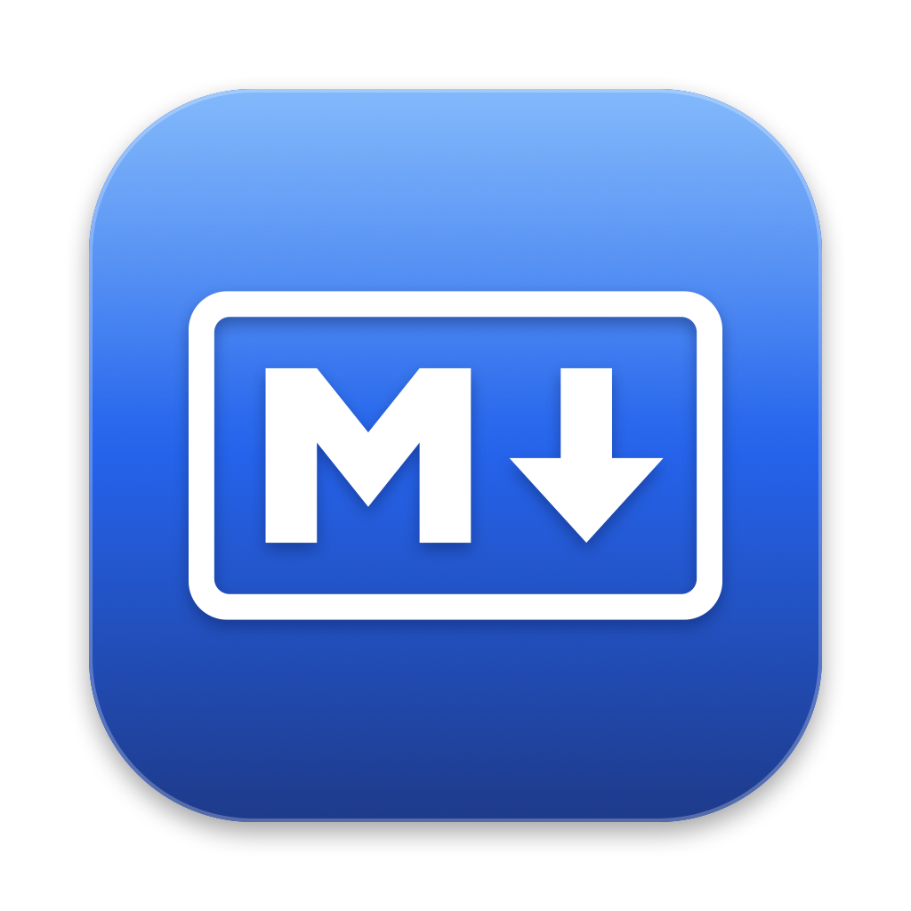

# Markdown Preview

A native Markdown editor for macOS with a live preview, plus a Quick Look extension: select a Markdown file in Finder, press **Space**, and see it rendered instead of raw text.

Inspired by [MacDown](https://github.com/MacDownApp/macdown), rebuilt from scratch in Swift for current macOS on Apple silicon.

## Features

**Editor**
- Live, side-by-side preview that keeps its scroll position while you type, with optional scroll sync
- Markdown syntax highlighting with editor themes (System, Solarized Light/Dark, Paper, Midnight), font, size and line spacing settings, and an optional readable line length
- Lists and quotes continue on Return; Tab / Shift-Tab indent list items; brackets and quotes close automatically
- Toolbar and shortcuts for bold, italic, strikethrough, highlight, headings, lists, task lists, quotes, code, links, images and tables
- Drop files onto the editor to link them; paste an image to save it next to the document and insert it
- Word count, reading time and cursor position in the status bar
- Export to HTML or PDF, Copy HTML, print
- Autosave, versions, tabs and full screen like any Mac document app

**Markdown**
- GitHub-flavoured Markdown: tables, task lists, ~~strikethrough~~, autolinks, fenced code, alerts (`> [!NOTE]`)
- Code highlighting for 45+ languages ([Prism](https://prismjs.com))
- TeX math, `$inline$` and `$$display$$` ([KaTeX](https://katex.org))
- Diagrams in ` ```mermaid ` blocks ([Mermaid](https://mermaid.js.org))
- Footnotes, `==highlight==`, `[TOC]` table of contents, YAML front matter, optional hard line breaks and smart punctuation
- Preview themes: GitHub, Clean, Paper, Solarized — all with light and dark variants

**Quick Look**
- Space in Finder shows a formatted preview using your chosen preview theme and Markdown settings
- Quick Look doesn't run scripts, so code highlighting, math and diagrams show as source there

Requires macOS 14 Sonoma or later on Apple silicon.

## Install

```bash
curl -fsSL https://raw.githubusercontent.com/LauLamanApps/markdown-preview/main/install.sh | bash
```

This downloads the source, builds it on your Mac and installs `MarkdownPreview.app` into `/Applications` (or `~/Applications` if `/Applications` isn't writable). Because it is built locally, Gatekeeper doesn't block it. The only requirement is the Xcode Command Line Tools; the script offers to install them if they're missing.

### From source

```bash
git clone https://github.com/LauLamanApps/markdown-preview.git
cd markdown-preview
make install
```

### Prebuilt download

Every [release](https://github.com/LauLamanApps/markdown-preview/releases) has a `MarkdownPreview-x.y.z.zip`. The build isn't notarized, so after unzipping, clear the quarantine flag before opening it:

```bash
xattr -dr com.apple.quarantine MarkdownPreview.app
mv MarkdownPreview.app /Applications/ && open /Applications/MarkdownPreview.app
```

## Usage

- **Edit:** open a file with **File → Open**, drag it onto the app, or use **Open With → Markdown Preview** in Finder. To make it the default, choose **Get Info → Open with → Markdown Preview → Change All**.
- **Layout:** ⌘1 editor only, ⌘2 side by side, ⌘3 preview only.
- **Settings** (⌘,): editor theme and font, typing behaviour, preview theme and appearance, Markdown extensions.
- **Quick Look:** select a `.md` file in Finder and press Space.

### Shortcuts

| Action | Shortcut |
|---|---|
| Bold / Italic | ⌘B / ⌘I |
| Strikethrough / Highlight | ⇧⌘X / ⇧⌘H |
| Inline code | ⇧⌘K |
| Link / Image / Table | ⌘K / ⇧⌘I / ⌥⌘T |
| Heading 1–3 / Body text | ⌥⌘1–3 / ⌥⌘0 |
| Bulleted / Numbered / Task list | ⇧⌘L / ⌥⌘L / ⌥⇧⌘L |
| Quote | ⌘' |
| Shift right / left | ⌘] / ⌘[ |
| Export HTML / Copy HTML | ⇧⌘E / ⌥⌘C |

### Quick Look still shows plain text?

1. Open **System Settings → General → Login Items & Extensions → Quick Look** and make sure **Markdown Preview** is enabled.
2. Reset Quick Look: `qlmanage -r && qlmanage -r cache`, then relaunch Finder (⌥-right-click the Finder icon → Relaunch).
3. Another app might have claimed `.md` previews. Turn its extension off in the same settings pane.

## Uninstall

```bash
make uninstall          # from a clone
# or
rm -rf /Applications/MarkdownPreview.app && qlmanage -r
```

## Development

Everything builds with the Command Line Tools — there is no Xcode project.

```bash
make app        # build build/MarkdownPreview.app
make install    # build, copy to /Applications and register the extension
make test       # renderer snapshot tests + a headless check that the preview scripts render
make release    # zip for distribution
```

`build/md2html file.md > out.html` renders a file the way Quick Look does. After changing a snapshot on purpose, regenerate it with `UPDATE=1 make test`.

Extension logs: `log stream --predicate 'subsystem == "nl.LauLamanApps.MarkdownPreview"' --info`

### Layout

```
Sources/Shared/     Markdown → HTML renderer, options, page template, image inlining
Sources/Extension/  Quick Look preview provider
Sources/App/        Editor: document, window, text view, highlighter, settings, menus
Sources/CLI/        md2html, used by the tests
Resources/Web/      Preview stylesheets and themes, preview.js, vendored Prism/KaTeX/Mermaid
Resources/          Info.plists and entitlements
Tests/              Snapshot cases and the headless preview check
```

### How it works

Markdown is converted to HTML by a small built-in renderer in Swift (`Sources/Shared`). The editor shows the result in a `WKWebView`; on every edit it swaps the page body in place, and `preview.js` runs Prism, KaTeX and Mermaid over it (KaTeX and Mermaid load only when a document uses them). The bundled scripts are served to the page through a custom `mdp://` URL scheme.

The Quick Look extension is a data-based preview: it returns the same HTML with the stylesheet inlined. It reads the editor's settings from the app's preferences file. Local images are inlined as `data:` URIs because neither preview can follow file references next to the document.

### Releasing

Push a tag like `v2.0.0`. The release workflow runs the tests, builds the app and attaches the zip to a GitHub release.

## License

MIT. The icons are built on the [Markdown Mark](https://github.com/dcurtis/markdown-mark) by Dustin Curtis (public domain); regenerate them with `make icons`. Third-party components are listed in [`ThirdPartyLicenses/`](ThirdPartyLicenses): Prism (MIT), KaTeX (MIT), Mermaid (MIT).
