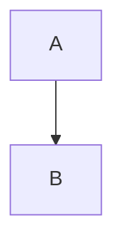

[TOC]

# Intro

Euler: $e^{i\pi} + 1 = 0$, costs $5 and $6, escaped \$x\$.

$$
\int_0^1 x^2\,dx = \frac{1}{3}
$$

```math
a^2 + b^2 = c^2
```

## Intro

A ==highlighted== phrase and a footnote[^note] plus another[^2].

[^note]: The note text
    with a continuation line.
[^2]: Second.



### Deep *heading*

Unknown footnote [^nope] stays.

```swift
let answer = 42 // the answer
func greet(_ name: String) -> String { "Hello, \(name)" }
```
